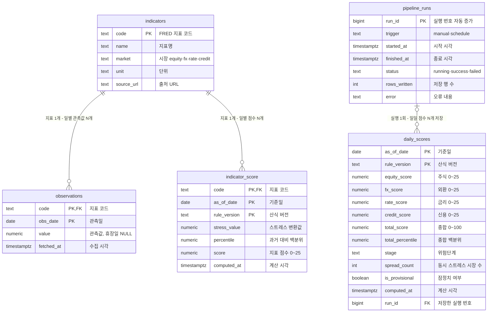

# DB 테이블 문서 — 금융시장 스트레스 모니터링 대시보드

| 항목 | 내용 |
|---|---|
| 프로젝트 | KAIST MBA 클라우드컴퓨팅실습 7조 · 금융시장 스트레스 모니터링 대시보드 |
| 문서 목적 | 서비스 DB의 테이블 구성, 컬럼, 기본키·외래키, 테이블 간 관계와 설계 근거 설명 |
| DB | Supabase PostgreSQL 17 (리전: 서울 `ap-northeast-2`, Free 플랜), `public` 스키마 |
| 기준 버전 | `db/schema.sql` **v0.1** (= Supabase 적용 버전) |
| 데이터 기준일 | 2026-10-17 (E2E 테스트 시점 운영 DB) |
| 작성 | 송수원 (A · 수집·DB 담당) · 2026-10-18 · 문서 v1.0 |

---

## 1. 설계 개요

### 1-1. 무엇을 저장하나 (개념 모델)

이 DB는 세 종류의 정보를 **서로 분리해서** 저장합니다.

| 구분 | 내용 | 테이블 |
|---|---|---|
| ① 기준 정보 | 어떤 지표를 쓰는가 (FRED 5개 지표) | `indicators` |
| ② 원천 데이터 | FRED에서 받은 일별 관측값 | `observations` |
| ③ 계산 결과 | 지표별 점수, 일일 종합점수 | `indicator_score`, `daily_scores` |
| ④ 운영 기록 | 수집·계산 실행의 성공·실패 이력 | `pipeline_runs` |

### 1-2. 설계 원칙

1. **원천과 계산 결과의 분리:** FRED 원본은 그대로 보존하고, 점수는 별도 테이블에 저장합니다. 산식이 바뀌어도 원본으로 다시 계산할 수 있습니다.
2. **조회 시 재계산 없음:** 사용자가 웹에 접속할 때마다 FRED를 호출하거나 점수를 계산하지 않습니다. 매일 한 번 계산한 결과를 저장해 두고 API는 읽기만 합니다.
3. **중복 없이, 지우지 않고:** 같은 지표·같은 날짜는 한 행만 존재하며(복합 기본키 + upsert), 저장한 과거 값은 삭제하지 않습니다(FRED S&P500은 최근 10년치만 제공하므로 한 번 지운 과거 값은 다시 받을 수 없음).

---

## 2. ERD (테이블 관계도)

| 관계 | 관계의 수 | 연결 방식 | 의미 |
|---|---|---|---|
| `indicators` → `observations` | 1 : N | 외래키 `observations.code` | 지표 1개에 날짜별 관측값 여러 개 |
| `indicators` → `indicator_score` | 1 : N | 외래키 `indicator_score.code` | 지표 1개에 날짜별 점수 여러 개 |
| `pipeline_runs` → `daily_scores` | 1 : N (선택) | 외래키 `daily_scores.run_id` | 실행 1회가 여러 날짜의 점수를 저장. 어느 실행이 저장했는지 추적 |
| `observations` ⇢ `indicator_score` ⇢ `daily_scores` | 논리적 관계 | 외래키 없음 (계산으로 연결) | 원본 → 지표 점수 → 같은 기준일·산식 버전의 지표 점수 5개를 모아 일일 점수 계산 |

---

## 3. 테이블 정의서

| 테이블 | 설명 | 기본키 | 쓰는 주체 | 읽는 주체 | 행 수 (10/17) |
|---|---|---|---|---|---|
| `indicators` | 지표 목록 (기준 정보) | `code` | 최초 1회 (`schema.sql`) | 파이프라인, API | 5 |
| `observations` | FRED 원천 일별 관측값 | `code` + `obs_date` | 수집 모듈 (A · `collect.py`, `db.py`) | 점수 계산, API | 25,347 |
| `indicator_score` | 지표별 스트레스 변환값·백분위·점수 | `code` + `as_of_date` + `rule_version` | 점수 계산 (B · `scoring.py`) | API | 24,093 |
| `daily_scores` | 일일 시장별·종합 점수, 위험단계 | `as_of_date` + `rule_version` | 점수 계산 (B · `scoring.py`) | API | 1,742 |
| `pipeline_runs` | 수집·계산 실행 이력 | `run_id` | 실행 관리 (C · `run.py`) | API (`/health`) | 12 |

※ 모든 쓰기는 파이프라인(`run.py`)만 하고, API(FastAPI)는 읽기만 합니다.

---

## 4. 컬럼 정의서

표기: **NULL** ✓ = 빈 값 허용 · ✗ = 필수 / **키** PK = 기본키, FK = 외래키

### 4-1. `indicators` — 지표 목록

| 컬럼 | 자료형 | NULL | 키 | 기본값·제약 | 설명 | 예시 |
|---|---|---|---|---|---|---|
| `code` | text | ✗ | PK | | FRED 시리즈 ID | `DGS10` |
| `name` | text | ✗ | | | 지표 한글명 | `미국 10년물 국채금리` |
| `market` | text | ✗ | | CHECK: `equity`, `fx`, `rate`, `credit` | 소속 시장 | `rate` |
| `unit` | text | ✗ | | | 단위 | `%` |
| `source_url` | text | ✓ | | | FRED 출처 페이지 | `https://fred.stlouisfed.org/series/DGS10` |

저장된 5개 지표:

| code | name | market | unit |
|---|---|---|---|
| `SP500` | S&P500 지수 | equity | index |
| `VIXCLS` | VIX 변동성지수 | equity | index |
| `DEXKOUS` | 원/달러 환율 | fx | KRW/USD |
| `DGS10` | 미국 10년물 국채금리 | rate | % |
| `BAA10Y` | Baa 회사채-10년물 금리차 | credit | %p |

### 4-2. `observations` — 원천 관측값

| 컬럼 | 자료형 | NULL | 키 | 기본값·제약 | 설명 | 예시 |
|---|---|---|---|---|---|---|
| `code` | text | ✗ | PK, FK → `indicators.code` | | 지표 코드 | `DGS10` |
| `obs_date` | date | ✗ | PK | | 관측일 (FRED 기준 날짜) | `2026-10-13` |
| `value` | numeric | ✓ | | | 관측값. FRED가 `"."`로 주는 휴장일은 **NULL** (0으로 바꾸지 않음) | `5.21` |
| `fetched_at` | timestamptz | ✗ | | 기본값 `now()` | 마지막으로 저장(갱신)한 시각 (UTC) | `2026-10-15 15:17:22+00` |

### 4-3. `indicator_score` — 지표별 점수

| 컬럼 | 자료형 | NULL | 키 | 기본값·제약 | 설명 | 예시 |
|---|---|---|---|---|---|---|
| `code` | text | ✗ | PK, FK → `indicators.code` | | 지표 코드 | `DGS10` |
| `as_of_date` | date | ✗ | PK | | 점수 기준일 | `2026-10-09` |
| `rule_version` | text | ✗ | PK | | 산식 버전 | `v0.1` |
| `stress_value` | numeric | ✓ | | | 스트레스 방향으로 바꾼 값 (예: 금리는 21관측 전 대비 변화폭 절댓값) | |
| `percentile` | numeric | ✓ | | 0~100 | 과거 최대 10년 분포 대비 백분위. 비교 기간 2년 미만이면 NULL | |
| `score` | numeric | ✓ | | 0~25 | 지표 점수 = 25 × max(0, (백분위 − 50) ÷ 50). 백분위 NULL이면 NULL | |
| `computed_at` | timestamptz | ✗ | | 기본값 `now()` | 계산·저장 시각 | |

### 4-4. `daily_scores` — 일일 종합점수

| 컬럼 | 자료형 | NULL | 키 | 기본값·제약 | 설명 | 예시 (2026-10-09) |
|---|---|---|---|---|---|---|
| `as_of_date` | date | ✗ | PK | | 점수 기준일 (5개 지표 점수가 모두 있는 날) | `2026-10-09` |
| `rule_version` | text | ✗ | PK | | 산식 버전 | `v0.1` |
| `equity_score` | numeric | ✓ | | 0~25 | 주식시장 = (S&P500 점수 + VIX 점수) ÷ 2 | `0.0` |
| `fx_score` | numeric | ✓ | | 0~25 | 외환시장 (원/달러) | `0.0` |
| `rate_score` | numeric | ✓ | | 0~25 | 금리시장 (미국 10년물) | 약 `14.6` |
| `credit_score` | numeric | ✓ | | 0~25 | 신용시장 (Baa 스프레드) | `0.0` |
| `total_score` | numeric | ✓ | | 0~100 | 종합점수 = 4개 시장점수의 합 | 약 `14.6` |
| `total_percentile` | numeric | ✓ | | 0~100 | 종합점수의 과거 백분위. 비교 기간 2년 미만(2021-10-12 이전)이면 NULL | 약 `39.8` |
| `stage` | text | ✓ | | CHECK: `정상`, `주의`, `경계`, `위험` | 위험단계 (백분위 75·90·95 기준). 백분위 NULL이면 NULL | `정상` |
| `spread_count` | integer | ✓ | | 0~4 | 12.5점 이상인 시장 수 (동시 스트레스) | `1` |
| `is_provisional` | boolean | ✗ | | 기본값 `false` | 잠정치 여부. 현재 방식(공통 기준일)에서는 항상 false | `false` |
| `computed_at` | timestamptz | ✗ | | 기본값 `now()` | 계산·저장 시각 | |
| `run_id` | bigint | ✓ | FK → `pipeline_runs.run_id` | | 이 점수를 저장한 실행 번호 | `5` |

※ 점수 값은 반올림하지 않고 저장하며, 화면에 표시할 때 반올림합니다.

### 4-5. `pipeline_runs` — 실행 이력

| 컬럼 | 자료형 | NULL | 키 | 기본값·제약 | 설명 | 예시 |
|---|---|---|---|---|---|---|
| `run_id` | bigint | ✗ | PK | 자동 증가 (IDENTITY) | 실행 번호 | `2` |
| `trigger` | text | ✗ | | CHECK: `manual`, `schedule` | 실행 방식 (직접 실행 / 예약 실행) | `manual` |
| `started_at` | timestamptz | ✗ | | 기본값 `now()` | 시작 시각 | `2026-10-10 12:30:12+00` |
| `finished_at` | timestamptz | ✓ | | | 종료 시각 (실행 중이면 NULL) | |
| `status` | text | ✗ | | CHECK: `running`, `success`, `failed` | 실행 결과 | `success` |
| `rows_written` | integer | ✓ | | | 저장한 행 수 | `25322` |
| `error` | text | ✓ | | | 실패 시 오류 내용 | NULL |

---

## 5. 키와 무결성 제약

### 5-1. 기본키 (5개)

| 테이블 | 기본키 | 이 조합을 키로 쓴 이유 |
|---|---|---|
| `indicators` | `code` | FRED 코드가 지표를 하나로 구분하는 공식 ID |
| `observations` | `code` + `obs_date` | **같은 지표의 같은 날짜는 값이 하나**. 매일 최근 14일을 다시 받아도 중복 행이 생기지 않고 덮어쓰기됨 |
| `indicator_score` | `code` + `as_of_date` + `rule_version` | 지표·날짜별 점수 1개. **산식 버전을 키에 포함**해 산식이 바뀌어도 이전 결과와 섞이지 않음 |
| `daily_scores` | `as_of_date` + `rule_version` | 날짜별 종합점수 1개, 산식 버전별 구분 |
| `pipeline_runs` | `run_id` | 실행마다 자동으로 붙는 일련번호 |

### 5-2. 외래키 (3개)

| 외래키 | 참조 | 막아 주는 것 |
|---|---|---|
| `observations.code` | `indicators.code` | 등록되지 않은 지표 코드의 데이터가 저장되는 것 |
| `indicator_score.code` | `indicators.code` | 등록되지 않은 지표의 점수가 저장되는 것 |
| `daily_scores.run_id` | `pipeline_runs.run_id` | 존재하지 않는 실행 번호가 기록되는 것 |

### 5-3. 무결성 제약 3종

| 무결성 | 뜻 | 이 DB에서 |
|---|---|---|
| **개체 무결성** | 모든 행을 하나로 구분할 수 있어야 함 | 5개 테이블 모두 기본키 지정, 키 컬럼은 NULL 불가 |
| **참조 무결성** | 다른 테이블을 가리키는 값은 실제로 있어야 함 | 외래키 3개 |
| **도메인 무결성** | 컬럼에는 허용된 값만 들어가야 함 | 자료형(date·numeric 등), NOT NULL, CHECK 4개 (`market`, `trigger`, `status`, `stage`) |

---

## 6. 설계 근거

### 6-1. 정규화: 중복 없이 나누기
- 지표 정보(이름·시장·단위)는 `indicators`에만 한 번 저장하고, 다른 테이블은 `code`로만 참조합니다. 지표명을 바꿔도 한 곳만 고치면 됩니다.
- `observations`는 **(지표, 날짜, 값) 한 줄씩 세로로 쌓는 구조**입니다. 지표가 늘어나도 테이블 구조를 바꿀 필요 없이 행만 추가됩니다.

### 6-2. 의도적 비정규화: 계산 결과를 저장하는 이유
- `indicator_score`와 `daily_scores`는 원본(`observations`)에서 다시 계산할 수 있는 값이라, 이론적으로는 저장하지 않아도 됩니다.
- 그래도 저장하는 이유는 **설계 원칙 2(조회 시 재계산 없음)** 때문입니다. 점수 계산에는 최대 10년치 과거 분포가 필요해서, 접속할 때마다 계산하면 무료 서버(Render)에서 응답이 느려집니다.
- `daily_scores`는 4개 시장 점수를 **가로 컬럼**으로 둡니다. 화면이 한 날짜의 4개 시장을 한 번에 보여 주므로, 한 행만 읽으면 되도록 했습니다.

### 6-3. 산식 버전(`rule_version`) 관리
- 점수 테이블의 기본키에 산식 버전을 넣었습니다. 산식이나 기준값이 바뀌면 새 버전으로 저장되어, **어떤 기준으로 계산한 점수인지** 항상 구분됩니다. 현재 버전은 `v0.1`입니다.

---

## 7. 데이터 흐름과 운영 규칙

### 7-1. 누가 쓰고 누가 읽나

| 단계 | 담당 | 구성요소 | 쓰는 테이블 | 읽는 테이블 |
|---|---|---|---|---|
| ① 수집 | A | FRED API → `collect.py` | — | — |
| ② 원본 저장 | A | `db.py` (upsert) | `observations` | — |
| ③ 점수 계산 | B | `scoring.py` | `indicator_score`, `daily_scores` | `observations` |
| ④ 실행 관리 | C | `run.py` (①~③ 순서·트랜잭션) | `pipeline_runs` | — |
| ⑤ 조회 | C | FastAPI (읽기 전용) | — | 5개 테이블 |
| ⑥ 표시 | D | 웹 화면 | — | (API를 통해서만) |

- 파이프라인(`run.py`)은 **GitHub Actions**가 매일 **06:17·08:17 (한국시간)** 두 번 자동 실행합니다 (`.github/workflows/pipeline.yml`). 2회차는 1회차가 지연·누락될 때를 위한 예비 실행이며, 같은 값은 덮어쓰기라 중복이 생기지 않습니다. 필요하면 GitHub Actions 화면에서 수동 실행도 할 수 있습니다 (`trigger = manual`).
- 실행 전에 점수 계산 테스트 50개를 먼저 돌려, 실패하면 DB에 쓰지 않고 중단합니다. **원본 저장과 점수 저장은 하나의 트랜잭션**으로 묶여, 중간에 실패하면 전부 취소되고 마지막 정상 결과가 그대로 남습니다.
- 실행 기록(`pipeline_runs`)은 별도로 즉시 저장되어, 실패해도 기록이 남습니다.

### 7-2. 데이터 품질 규칙

| 규칙 | 내용 | 이유 |
|---|---|---|
| 결측 = NULL | 휴장일은 0이 아니라 NULL로 저장, 계산에서 제외 | 0으로 채우면 하루 사이 값이 폭락한 것처럼 보여 점수가 왜곡됨 |
| 덮어쓰기 저장 (upsert) | 같은 (지표, 날짜)가 다시 오면 값만 갱신 | 늦게 공개되거나 수정된 값을 반영하면서 중복 방지 |
| 최근 14일 재수집 | 매일 최근 14일을 다시 받음 | 늦은 공개(원/달러 최대 8일), 수정값, 실행이 빠진 날 자동 보정 |
| 삭제 금지 | 코드에 삭제 기능 없음, `schema.sql`에 DROP·DELETE 없음 | FRED S&P500은 10년치만 제공. 현재 DB에는 FRED에서 이미 사라진 2016-10-10부터 보존 |
| 전부 아니면 전무 | 지표 하나라도 수집 실패 시 그날 저장 전체 취소 | 일부 지표만 갱신된 불완전한 점수 방지 |

### 7-3. 인덱스

| 인덱스 | 대상 | 용도 |
|---|---|---|
| 기본키 인덱스 (자동) | 5개 테이블 기본키 | 지표·날짜로 한 행을 빠르게 찾기, 중복 방지 |
| `observations_obs_date_idx` | `observations(obs_date)` | 기간 조회(`/indicators/{code}/observations?from=&to=`)를 빠르게 |

### 7-4. 보안

- DB 접속 정보(`DATABASE_URL`)와 FRED API 키는 **코드에 넣지 않고 환경변수로만** 사용합니다 (로컬, Render, GitHub Secrets).
- Supabase가 테이블을 인터넷 API로 자동 공개하는 기능(Data API)은 **끄고**, 5개 테이블에 **RLS(행 단위 접근 잠금)**를 켰습니다. 서비스는 테이블 소유자 계정으로 직접 접속하므로 영향을 받지 않습니다.
- 화면(프론트엔드)은 DB에 직접 접근하지 않고 FastAPI를 통해서만 데이터를 받습니다.

---

## 8. 현재 데이터 현황과 변경 이력

### 8-1. 원천 데이터 현황

| 지표 | 수집 기간 | 관측 수 | 결측(NULL) |
|---|---|---|---|
| `DEXKOUS` 원/달러 | 2005-01-03 ~ 2026-10-09 | 5,680 | 224 |
| `DGS10` 미국 10년물 | 2005-01-03 ~ 2026-10-13 | 5,682 | 233 |
| `SP500` S&P500 | 2016-10-10 ~ 2026-10-14 | 2,613 | 96 |
| `VIXCLS` VIX | 2005-01-03 ~ 2026-10-14 | 5,683 | 170 |
| `BAA10Y` 신용스프레드 | 2005-01-03 ~ 2026-10-13 | 5,682 | 238 |
| **합계** | | **25,340** | **961** |

※ 위 표는 2026-10-16 수집 기준 지표별 상세입니다. 2026-10-17 기준 전체 25,347행이며, 지표별 최신 관측일은 S&P500 10-16, 미국 10년물·VIX·신용스프레드 10-15, 원/달러 10-09입니다 (FRED 공개 지연).

- 점수(`daily_scores`): 2019-10-09 ~ 2026-10-09, 1,742일. 위험단계는 2021-10-12부터 산출 (S&P500 데이터 기간 제약으로 비교 기간 2년 확보 이후)

### 8-2. 스키마 변경 이력

| 버전 | 날짜 | 작성 | 내용 |
|---|---|---|---|
| v0.0 | 2026-10-10 | 김태현 (C) | 초안: 5개 테이블, 지표 5개 초기 입력 |
| v0.1 | 2026-10-10 | 송수원 (A) | `observations(obs_date)` 인덱스 추가, 5개 테이블 RLS 활성화. Supabase 적용 (10/10), 저장소 반영 (`rel-v0.3`, 10/16) |

### 8-3. 한계

- Supabase 무료 플랜은 자동 백업이 없어, 초기 적재 데이터를 CSV(25,322행, 2026-10-10)로 별도 보관합니다.
- 무료 플랜은 7일간 접속이 없으면 일시 정지됩니다. 매일 자동 수집(GitHub Actions)이 DB에 접속하므로 운영 중에는 해당되지 않습니다.

---

## 9. 검증 결과

2026-10-17 통합 테스트(E2E, 김태현 실행, 대상 커밋 `fa8deea`) 중 DB·데이터 관련 항목입니다. 운영 DB는 읽기 전용으로만 확인했고, 저장·장애 시험은 별도 테스트 DB에서 했습니다.

| 항목 | 확인한 것 | 결과 |
|---|---|---|
| 원본 정확도 (K02) | 운영 DB 값과 FRED 원본을 무작위 25개 대조 (허용 오차 1e-6) | **25/25 일치** |
| 지표 커버리지 (K01) | 5개 지표 모두 값·관측일 존재 | 5/5 |
| 결측 처리 (K03) | 최근 1년 FRED `"."` 46건이 모두 DB NULL, 0으로 저장된 값 0건 | PASS |
| 중복 방지 (K04) | 같은 데이터 2회 저장·`--days 14` 2회 실행 후 중복 0, 행 수 불변 | PASS |
| 덮어쓰기 저장 (M-A5) | 같은 날짜 값을 바꿔 다시 저장 → 행 수 유지, 새 값 반영 | PASS |
| 트랜잭션 (M-A6) | 저장 함수는 확정(commit)하지 않음 → 취소(rollback) 시 저장 전 상태로 복귀 | PASS |
| NULL 왕복 (M-A7) | 빈 값 저장 → DB NULL → 읽을 때 NaN | PASS |
| 스키마 (M-A8) | `schema.sql` 2회 실행 오류 없음, 지표 5행, 5개 테이블 RLS 활성 | PASS |
| 실패 격리 (K13) | 수집·계산 실패 시 데이터 변화 0, `pipeline_runs`에 `failed`와 오류 기록 | PASS |
| 보안 (K19) | 전체 커밋 이력에 비밀값 0건, DB 오류 응답에 접속 정보 노출 0 | PASS |
| 점수 정합 (K05~K08) | `daily_scores` 1,742행 전체: 시장합 = 종합, 주식 = (S&P500+VIX)/2, 단계·백분위 일치 | 위반 0 |

## 10. 문서 이력

| 버전 | 날짜 | 내용 |
|---|---|---|
| v0.9 | 2026-10-17 | 초안 (테이블·컬럼 정의서, ERD, 설계 근거, 운영 규칙) |
| v1.0 | 2026-10-18 | 10/17 데이터 현황 반영, GitHub Actions 자동 실행(06:17·08:17 KST) 반영, 9장 검증 결과 추가 |

